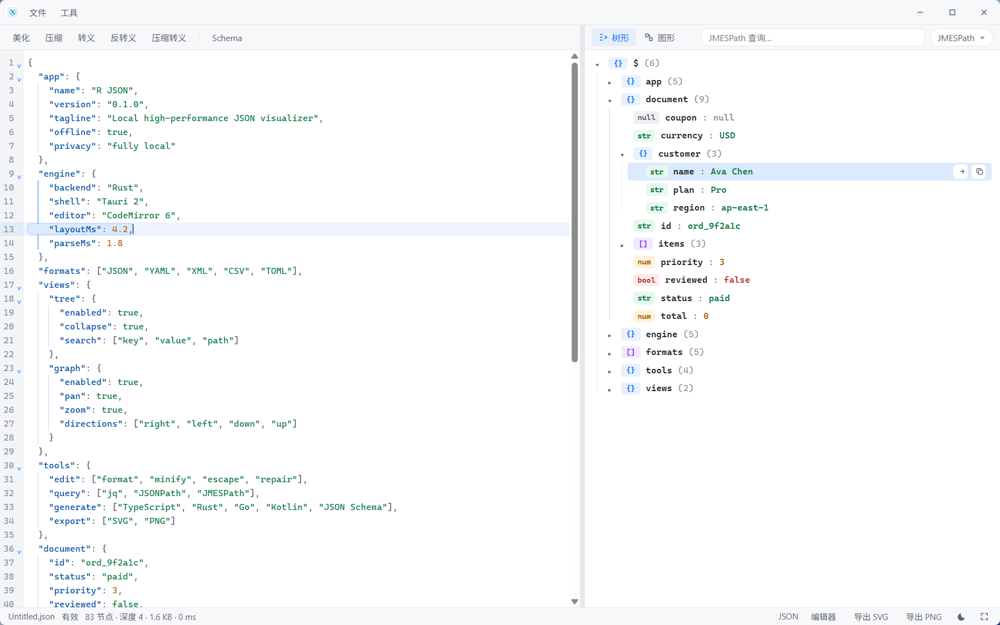
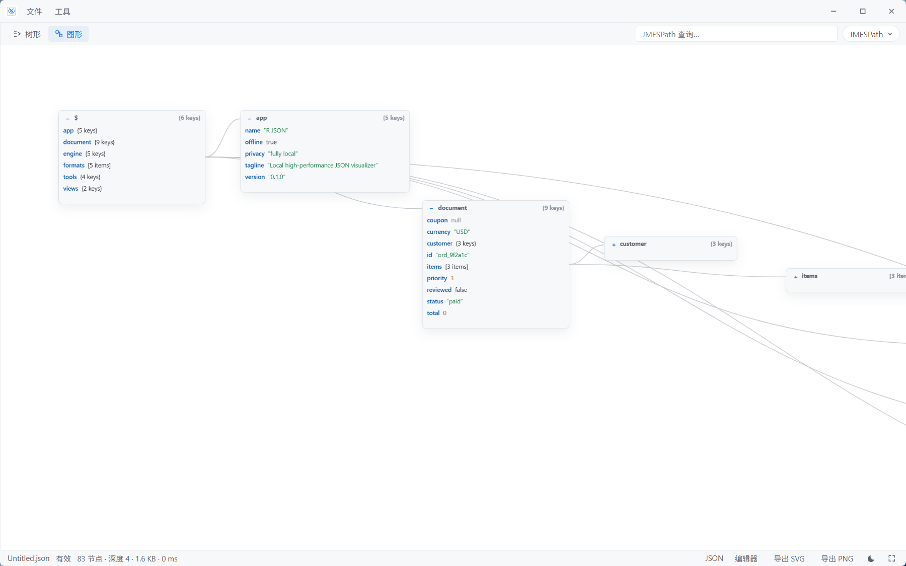

<div align="center">
  
  <h1>R JSON</h1>
  <p>
    <strong>本地、高性能的 JSON 可视化工具，基于 Rust 与 Tauri 2 构建。</strong>
  </p>
  <p>
    在本机完成 JSON 的解析、查看、转换、查询与代码生成。
  </p>
  <p>
    
    
    
    
    
  </p>
  <p>
    
    
    
    
    
  </p>
  <p>
    <a href="README.md">English</a> | 中文
  </p>
  <p>
    
  </p>
  <p>
    
  </p>
</div>

JSON、YAML、XML、CSV、TOML 的解析与索引都在 Rust 中完成。图布局、并行搜索、格式转换、JSON Schema、代码生成、jq、JSONPath、JMESPath 同样运行在 Rust 进程里。Webview 只渲染当前视口，大文件不必整棵拷进 DOM。

## 功能

- 交互式 **树形** 与 **图形** 视图，支持平移、缩放、折叠，以及四种布局方向
- 实时编辑器：校验、美化、压缩、转义 / 反转义、修复尾逗号
- **JSON**、**YAML**、**XML**、**CSV**、**TOML** 互相转换
- 生成 **TypeScript**、**Rust**、**Go**、**Kotlin** 与 **JSON Schema**
- 支持 **jq**、**JSONPath**、**JMESPath** 查询
- 按键名、值、路径并行搜索
- 深色 / 浅色主题、拖放打开、全屏、导出 SVG 与 PNG
- 全部在本地处理，数据不会离开本机

## 运行

```powershell
npm install
npm run tauri dev
```

发布构建会启用 LTO 与原生优化：

```powershell
npm run tauri build
```

## 鸣谢

R JSON 离不开这些开源项目：

| 项目 | 用途 |
| --- | --- |
| [Tauri](https://github.com/tauri-apps/tauri) | 桌面壳：原生窗口 + Rust 后端 |
| [Rust](https://www.rust-lang.org/) | 解析、索引、布局、搜索、转换、代码生成与查询 |
| [serde](https://github.com/serde-rs/serde) / [serde_json](https://github.com/serde-rs/json) | JSON 序列化与内存文档模型 |
| [serde_yaml](https://github.com/dtolnay/serde-yaml) | YAML 导入导出 |
| [toml](https://github.com/toml-rs/toml) | TOML 导入导出 |
| [quick-xml](https://github.com/tafia/quick-xml) | XML 转换 |
| [csv](https://github.com/BurntSushi/rust-csv) | CSV 转换 |
| [jaq](https://github.com/01mf02/jaq) | 兼容 jq 的查询 |
| [rayon](https://github.com/rayon-rs/rayon) | 并行搜索 |
| [CodeMirror](https://github.com/codemirror/dev) | Webview 中的 JSON 编辑器 |
| [Vite](https://github.com/vitejs/vite) | 前端构建工具 |
| [JSON Crack](https://github.com/AykutSarac/jsoncrack.com) | 原始界面与思路（Apache-2.0） |

JSON Crack 的界面与思路来自 [AykutSarac/jsoncrack.com](https://github.com/AykutSarac/jsoncrack.com)，采用 Apache-2.0 许可。本项目是独立的 Rust / Tauri 实现，并未复制其源码。
